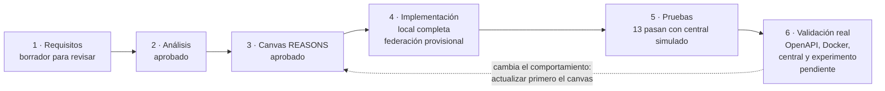
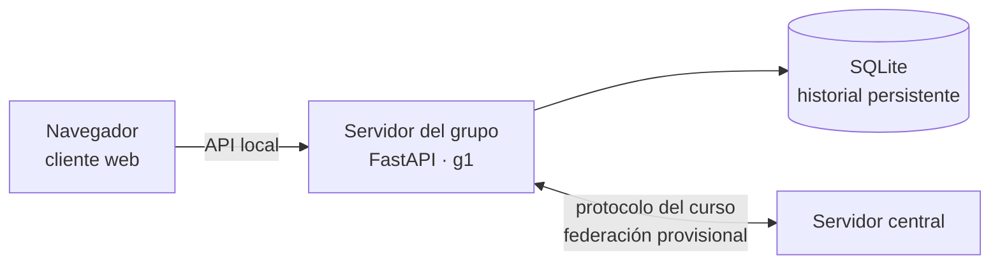

# Chat distribuido

Proyecto académico de Sistemas Distribuidos: un chat web para el grupo `g1`,
con servidor FastAPI, almacenamiento SQLite y una integración provisional con
el servidor central del curso.

> **Estado importante:** el chat local está implementado. La federación se
> probó con un central simulado, pero todavía no se ha verificado contra el
> contrato OpenAPI ni contra el servidor real del curso. No se incluyen
> resultados inventados de experimento o interoperabilidad.

## Entregables de la guía

| Entregable | Dónde está | Estado |
|---|---|---|
| Servidor y cliente del chat | [`app/`](app/) | Implementados |
| Ejecución con Docker Compose | [`Dockerfile`](Dockerfile), [`docker-compose.yml`](docker-compose.yml) | Imagen construida; chat local verificado por HTTP |
| Instrucciones y variables de entorno | Este README, [`.env.example`](.env.example) | Disponibles; federación sujeta a validación |
| Diagrama de arquitectura | [`docs/arquitectura.md`](docs/arquitectura.md) | Disponible |
| Pruebas automatizadas | [`tests/`](tests/) | 13 pruebas pasaron en la última validación; usan federación simulada |
| Especificación OpenAPI y prueba de conformidad | Aún no disponibles en los materiales revisados | Pendiente |
| Experimento: script, datos y resultados de al menos tres repeticiones | Aún no preparados | Pendiente; no se reportan resultados sin ejecutarlo |
| Bitácora de interoperabilidad | Aún no preparada | Pendiente de probar con el central y otro grupo |
| Guion y póster final | Aún no preparados | Pendiente; deben basarse en evidencias reales |

La lista completa de requisitos y sus páginas de origen está en
[CHAT-001-requisitos.md](spdd/requirements/CHAT-001-requisitos.md).
Las tareas para terminar la entrega, sus dependencias y las decisiones abiertas
están en el [plan de entrega](spdd/plan-entrega.md).

## Estado y flujo SPDD

El proyecto sigue SPDD (*Structured Prompt-Driven Development*): se registran
los requisitos, se analizan hechos y pendientes, se aprueba el canvas antes de
implementar y se prueba cada etapa. Si cambia un requisito, primero se actualiza
el canvas y luego el código.



Los documentos SPDD y el log de decisiones están organizados en
[`spdd/`](spdd/README.md). El proyecto está publicado en la rama
[`compartir/proyecto-inicial`](https://github.com/Maria-Fernanda-Ruiz/sistemasproyecto/tree/compartir/proyecto-inicial).

## Integrantes

| Integrante |
|---|
| Maria Fernanda Ruiz Velasquez |
| Karen Angelica Sandoval Martinez |

Maria y Karen trabajan en igualdad como equipo. El [plan de entrega](spdd/plan-entrega.md)
organiza las tareas pendientes para que acuerden cómo coordinarlas; cualquier
responsabilidad individual es solo para organizarse y no representa una
diferencia en el trabajo o aporte de cada una. El repositorio es público y
Karen ya tiene acceso como colaboradora, según confirmó Maria.

## Qué construimos

El navegador usa la API local del servidor del grupo. Ese servidor guarda
usuarios y mensajes en SQLite y, cuando se configura, se comunica con el
servidor central para compartir y recuperar mensajes de `#general`.



La API entre el navegador y este servidor es propia del proyecto. El protocolo
entre servidores debe cumplir la especificación del curso. La guía permite un
cliente web sencillo, una sola sala compartida `#general` y almacenamiento
persistente.

| Método y ruta | Uso |
|---|---|
| `GET /` | Abre el cliente web. |
| `POST /users` | Crea un usuario local. |
| `POST /messages` | Envía un mensaje desde un usuario local. |
| `GET /messages` | Lee el historial para el cliente. |
| `GET /fed/health` | Informa el grupo y el reloj Lamport al central. |
| `POST /fed/messages` | Recibe un mensaje reenviado por el central. |

Más detalles del flujo: [diagrama de arquitectura](docs/arquitectura.md).

## Inicio rápido con Docker Compose

Necesitas Docker Desktop instalado y en ejecución, con Docker Compose
disponible.

1. Abre esta carpeta en Visual Studio Code.
2. Abre **Terminal → Nuevo terminal**.
3. Copia el archivo de ejemplo de configuración:

   ```sh
   cp .env.example .env
   ```

4. Para ejecutar solo el chat local, deja `CENTRAL_URL` y `PUBLIC_URL` vacías.
5. Inicia los servicios:

   ```sh
   docker compose up --build
   ```

6. Cuando Uvicorn indique que escucha en el puerto `8000`, abre
   <http://localhost:8000>.
7. Para detenerlo, pulsa `Ctrl+C`.

Los datos se guardan en el volumen Docker `chat-data` y se conservan al
reiniciar. `docker compose down` elimina el contenedor, pero conserva el
volumen. No uses `docker compose down -v` si quieres conservar el historial.

**Verificación local:** la imagen se construyó correctamente. El contenedor
respondió `HTTP 200` en `/` y `/fed/health` devolvió `{"server":"g1","lamport":0}`.
Esta prueba fue en modo local, sin conexión configurada con el servidor central.

## Configuración de la federación

Para intentar conectar con el central, configura `.env` con los datos oficiales
proporcionados por el curso:

```dotenv
GROUP_ID=g1
CENTRAL_URL=
PUBLIC_URL=
```

| Variable | Uso | Valor por defecto |
|---|---|---|
| `GROUP_ID` | Identificador del grupo | `g1` |
| `CENTRAL_URL` | Dirección base del servidor central | Vacío (modo local) |
| `PUBLIC_URL` | Dirección pública desde la que el central llega a este servidor | Vacío |
| `HEALTH_INTERVAL_SECONDS` | Intervalo entre consultas de salud | `5` |
| `HEALTH_FAILURE_THRESHOLD` | Fallos para marcar el central como caído | `3` |
| `REGISTRATION_INTERVAL_SECONDS` | Intervalo para renovar el registro | `30` |
| `RETRY_INITIAL_SECONDS` | Espera inicial para reintentos | `1` |
| `RETRY_MAX_SECONDS` | Límite de espera entre reintentos | `30` |

La URL pública debe permitir que el central alcance las rutas
`/fed/health` y `/fed/messages`. La guía menciona Cloudflare, pero no se
proporcionaron instrucciones ni credenciales para configurar un túnel.

### Contrato provisional

La integración sigue las rutas y los campos resumidos en el PDF. La guía indica
que la especificación OpenAPI completa prevalece. Como no estaba entre los
materiales revisados, `GET /history?since=...` se implementó provisionalmente
suponiendo que responde con una lista JSON directa. No se debe considerar
verificada la interoperabilidad hasta probarla contra la especificación y el
servicio real.

## Ejecución local sin Docker

Se requiere Python 3.12 o posterior. Desde la carpeta del proyecto:

```sh
python -m venv .venv
```

Activa el entorno virtual y luego instala dependencias e inicia el servidor:

```sh
python -m pip install -r requirements.txt
python -m uvicorn app.main:app --reload
```

Abre <http://localhost:8000>. Los datos se guardan por defecto en
`data/chat.sqlite3`. Para cambiar esa ruta, configura `CHAT_DB_PATH`.

## Pruebas

```sh
python -m unittest discover -s tests -v
```

Las pruebas revisan usuarios, mensajes, persistencia, migración, registro,
reintentos, recuperación del historial, deduplicación y reloj Lamport. Las
pruebas de federación usan un central simulado: no sustituyen la prueba con el
servidor del curso.

## Estado de entrega

Antes de entregar todavía se necesita:

- obtener y seguir la especificación OpenAPI y el script oficial de conformidad;
- construir y ejecutar la imagen con Docker;
- configurar una URL pública y probar con el central y otro grupo;
- realizar al menos tres repeticiones del experimento y guardar script, datos,
  tabla y gráfica;
- documentar la interoperabilidad en una bitácora;
- completar el guion y el póster en la plantilla original, usando resultados
  reales.
