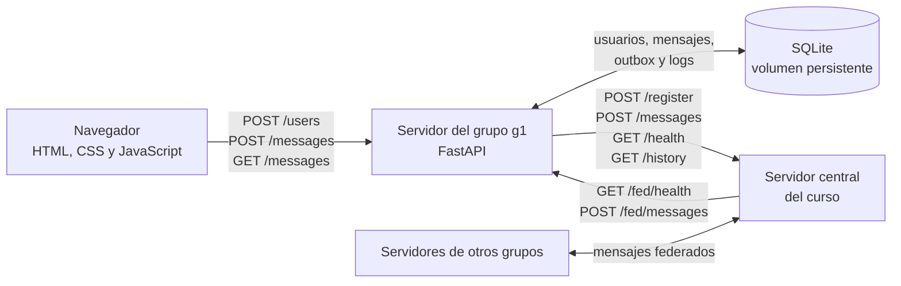

# Arquitectura

## Flujo de mensajes

1. El navegador crea o selecciona un usuario y manda mensajes al servidor `g1`.
2. `g1` guarda el mensaje y su entrada de outbox en SQLite antes de intentar
   entregarlo al central.
3. El worker de federación reintenta errores de red y respuestas HTTP 5xx con
   espera exponencial. Ante respuestas HTTP 4xx, registra el descarte.
4. El central reenvía mensajes a los servidores registrados en sus rutas
   `/fed/messages`.
5. `g1` identifica mensajes repetidos por `id`, persiste los nuevos y actualiza
   su reloj de Lamport. El navegador consulta el historial local cada 2 segundos.
6. Al iniciar y después de recuperar la conexión, `g1` consulta el historial
   central posterior a su marca Lamport.

Las rutas entre servidores siguen el resumen del PDF. El contrato completo
OpenAPI y una prueba contra el servidor central siguen pendientes; la respuesta
de historial como lista JSON directa es un supuesto provisional.
